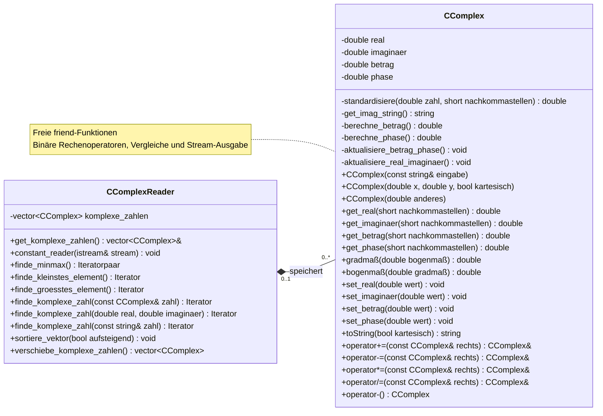
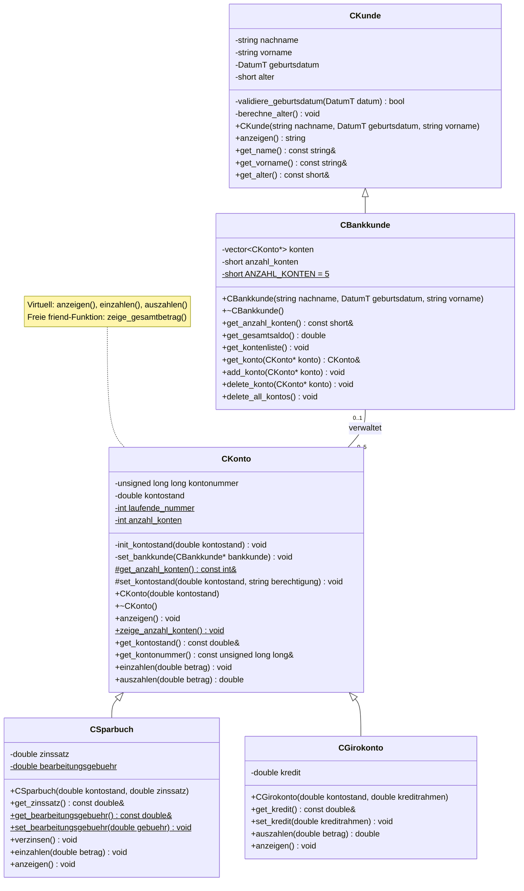

<a name="top"></a>

<div align="center">

# Objektorientierte Programmierung

---

Dieses Repository dient den Hausaufgaben und der Klausurvorbereitung für das Modul
Objektorientierte Programmierung. 


### **Studentisches Lernprojekt - Keine offizielle Hochschulvorlage, oder Musterlösung!**


[](#einstieg)
[](#struktur)
[](#uml)


---
**Stand: 26.11.2026** - In Bearbeitung

</div>

---

<a name="einstieg"></a>

## Einstieg

---

### Voraussetzungen

---
| Werkzeug | Anforderung | Lokales Setup unter Windows                  |
| --- | --- |----------------------------------------------|
| C++-Compiler | Unterstützung für `C++20` | MinGW-w64 mit GCC 13.1.0 aus Qt-Installation |
| CMake | Version `4.2` oder neuer | CMake 4.3.1 aus `CLion`                      |
| Ninja | Build mit `-G Ninja` | Ninja 1.13.2 aus `CLion`                     |
| CTest | Ausführen der automatisierten Tests | In `CMake` enthalten                         |


>Qt liefert in diesem Setup den MinGW-Compiler.
>Das Projekt verwendet bisher keine Qt-Bibliotheken und baut auch mit
>einem anderen C++20-fähigen Compiler.

---

### Bauen und Testen

```shell
 # CMake, CTest und MinGW in PowerShell verfügbar machen
 $env:Path = "$env:LOCALAPPDATA\Programs\CLion\bin\cmake\win\x64\bin;C:\Qt\Tools\mingw1310_64\bin;$env:Path"

 # Hauptprogramme und Testprogramme kompilieren
 cmake --build cmake-build-debug

 # Alle registrierten Tests ausführen
 ctest --test-dir cmake-build-debug --output-on-failure --no-tests=error

 # Hauptprogramme starten
 $env:Path = "$env:LOCALAPPDATA\Programs\CLion\bin\cmake\win\x64\bin;C:\Qt\Tools\mingw1310_64\bin;$env:Path"
 cmake --build cmake-build-debug --target run_all

 # Isolierte Tests durchführen (CBankkunde)
 ctest --test-dir cmake-build-debug -R '^CBankkunde$' --output-on-failure

```

---

<a name="struktur"></a>

## Struktur

---

```text
OOP/
├── src/
│   ├── kontoverwaltung/
│   │   ├── konten/
│   │   │   ├── CGirokonto.cpp
│   │   │   ├── CKonto.cpp
│   │   │   └── CSparbuch.cpp
│   │   ├── kunden/
│   │   │   ├── CBankkunde.cpp
│   │   │   └── CKunde.cpp
│   │   └── main_kontoverwaltung.cpp
│   ├── komplexe_zahlen/
│   │   ├── CComplex.cpp
│   │   ├── CComplexReader.cpp
│   │   └── main_CComplex.cpp
│   └── funktionstemplates/
│       └── main_funktionstemplates.cpp
├── incl/
│   ├── kontoverwaltung/
│   │   ├── konten/
│   │   │   ├── CGirokonto.h
│   │   │   ├── CKonto.h
│   │   │   └── CSparbuch.h
│   │   └── kunden/
│   │       ├── originale/
│   │       │   └── CKunde.h
│   │       ├── CBankkunde.h
│   │       └── CKunde.h
│   ├── komplexe_zahlen/
│   │   ├── CComplex.h
│   │   └── CComplexReader.h
│   └── funktionstemplates/
│       └── main_funktionstemplates.h
├── tests/
│   ├── komplexe_zahlen/
│   │   ├── test_CComplex.cpp
│   │   └── test_CComplexReader.cpp
│   └── kontoverwaltung/
│       ├── test_CBankkunde.cpp
│       ├── test_CGirokonto.cpp
│       ├── test_CKonto.cpp
│       ├── test_CKunde.cpp
│       └── test_CSparbuch.cpp
├── .gitignore
├── .gitlab-ci.yml
├── CMakeLists.txt
└── README.md
```

---

<a name="uml"></a>

## UML-Klassendiagramm Komplexe Zahlen

---



---

## UML-Klassendiagramm Kontoverwaltung

---




<div align="center">

[](https://github.com/p-keminer/objektorientierte-programmierung-thga)
[](https://gitlab.thga.de/philip.keminer/OOP)
[](#top)

</div>
